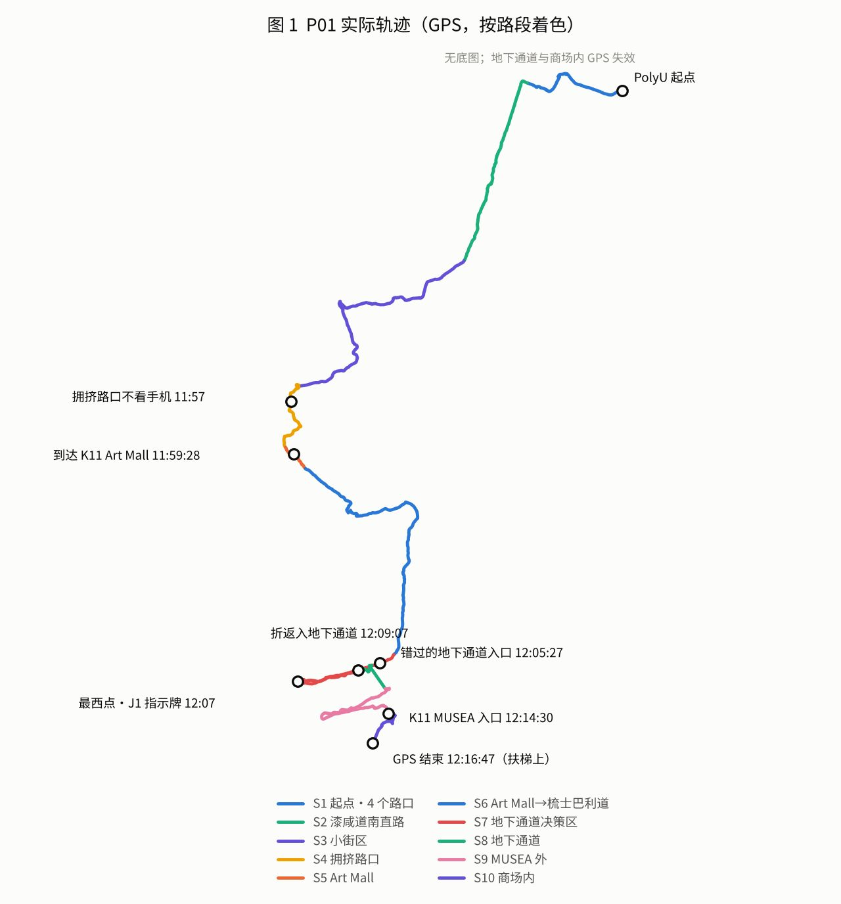
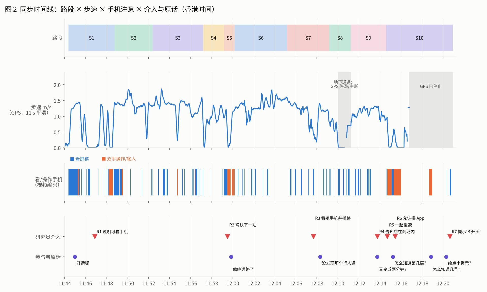
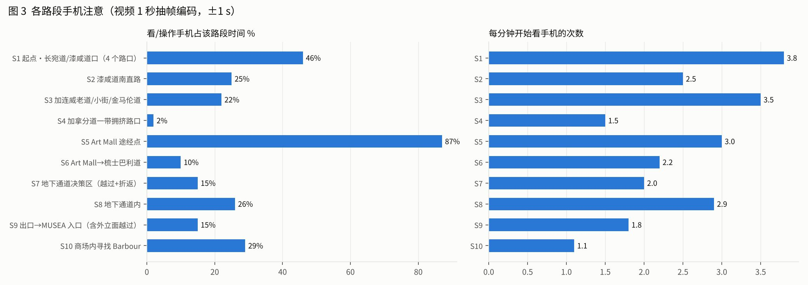
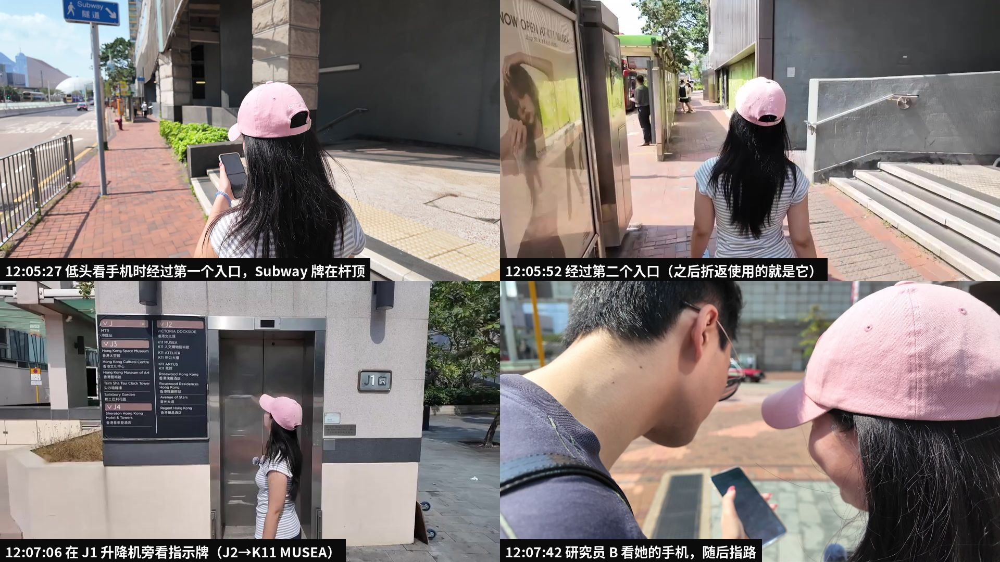
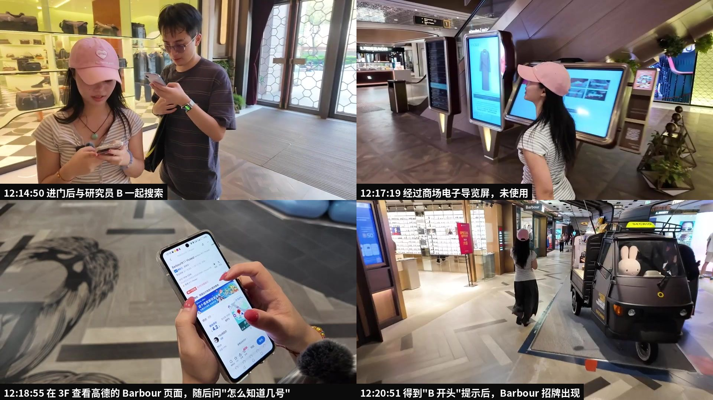
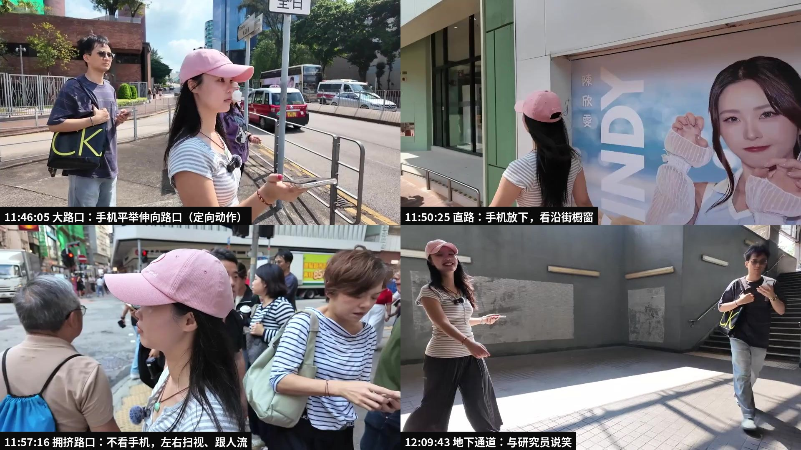

# P01 · UserA-Sarah · 视频优先的观察解析与 Insights 报告

**状态：研究者分析稿（v1，2026-10-28），待团队核对。** 本报告先不看研究员语音笔记，只用视频画面和音轨独立重建整场观察，最后再与语音笔记对照。它替代 [10-27 初稿](P01_2026-10-27_UserA_observation-analysis.md) 中与视频不一致的判断（见第 6 节）。

单个案例只能提出问题和假设，不能证明负担或因果。下文每条结论都标注证据层次：

- **观察**：画面或音轨可直接看到、听到的内容。
- **原话**：参与者当场说的话。
- **事后**：走后访谈中的回答。
- **解读**：研究者的推断。

## 0. 摘要

1. **困难不是平均分布的，而是集中在四个"转换点"**：途经点切换、平面转地下通道、室外转商场入口、入口到楼层再到铺位。3 次实质性的研究员帮助全部落在这些点上。
2. **错过地下通道的那一刻，她正低头看手机。** 12:05:27 她看着屏幕走过第一个入口，蓝色"Subway 隧道"牌挂在杆顶，高于视线；25 秒后又走过第二个入口。折返损失约 3 分 15 秒。
3. **环境里有正确信息，但"语言不对"。** 她停在 J1 升降机前看了指示牌，牌上写着"J2 → K11 MUSEA"，但这是港铁出口编码，她没有据此行动，随即转向研究员求助。
4. **手机注意随情境明显变化。** 全程约 24% 的时间在看或操作手机，平均每分钟看 2.4 次。各路段差别很大：起点 46%，Art Mall 途经点 87%；直路 25% 且后段几乎为 0；拥挤路口只有 2%，她改为扫视和跟随人流。
5. **注意力不只在"导航"和"安全"之间分配，还有探索与社交。** 她大量时间在看橱窗、涂鸦、小吃和菜单，与研究员说笑约 20 余次；她自己也说"可以顺便逛"。
6. **快到终点时，信息需求发生了跃迁**：从"往哪走"变成"入口在哪、第几层、几号、店长什么样、Barbour 是什么"。三个工具都没完全覆盖：Google 地图的剩余时间反复跳动，高德能查到楼层，商场电子导览屏她经过两次都没用。
7. **"成功到达"部分是研究员共同完成的。** 共有 7 次介入。其中被称为"路人"的指路者，从画面和声纹看是研究员 B（需要你确认，见 E07）。

## 1. 方法与证据

| 资料 | 处理方法 | 产出 |
|---|---|---|
| DJI 0453（正式任务，37 分 38 秒） | 转成 4 fps 代理文件；**逐秒抽帧共 2,259 张，全部按张查看并编码**；关键时刻另取 4 fps 连续帧和 1080p 原片静帧 | [逐秒编码日志](P01_video_coding_log.md)、[手机注意区间](P01_phone_intervals.tsv) |
| DJI 0452（warm-up）、IMG_1762（任务说明）、IMG_1770 | 每 3 秒抽帧查看，并做转写 | 任务说明和 warm-up 指令 |
| DJI 0453 音轨 | VAD 分段 + 3 人声纹聚类 + SenseVoice 离线识别 | [分说话人转写](P01_2026-10-27_walk-audio_diarized_ASR.md) |
| 参与者 GPX | 逐秒解析速度、停留、断点和距离 | 路段距离与步速 |
| **时钟同步** | 用 IMG_1770 与 DJI 音轨做互相关，得出 **DJI 时钟比手机快 931.5 秒**（相关系数 0.72）；视频运动量与 GPS 步速的相关独立给出 931–935 秒 | 全部时间统一为香港时间 |

人物：P01 = 参与者（佩戴领夹麦）；**B = 随行研究员**（条纹 T 恤、戴眼镜、背 CK 袋，全程对手机口述，应为语音笔记的记录者）；**C = 摄像**（白帽，手持 DJI Pocket，12:21:48 自拍时露面）。**现场是两名研究员跟一位参与者，不是手册规定的一对一。**

## 2. 全程概览

| 路段 | 香港时间 | 时长 | GPS 距离 | 手机注意 | 主要特征 |
|---|---|---|---|---|---|
| S1 起点·4 个路口 | 11:44:22–11:48:46 | 4:25 | 176 m | 46% | 两次长红灯（共约 110 秒）；R1 |
| S2 漆咸道南直路 | 11:48:46–11:52:22 | 3:37 | 294 m | 25% | 前 45 秒持续用手机，之后约 2.8 分钟几乎不看，改看橱窗 |
| S3 加连威老道·小街·金马伦道 | 11:52:22–11:57:10 | 4:49 | 422 m | 22% | 短而频繁地看（3.5 次/分钟）；同时在看涂鸦和小吃 |
| S4 拥挤路口 | 11:57:10–11:59:10 | 2:01 | 132 m | **2%** | 不看手机，扫视、跟随人流 |
| S5 Art Mall 途经点 | 11:59:10–12:00:10 | 1:01 | 51 m | **87%** | 路线短暂消失；R2 |
| S6 Art Mall → 梳士巴利道 | 12:00:10–12:05:10 | 5:01 | 447 m | 10% | 长段不看手机；K11 MUSEA 立面已进入视野 |
| S7 地下通道决策区 | 12:05:10–12:09:10 | 4:01 | 277 m | 15% | 走过两个入口，越过约 85 m 后折返；R3 |
| S8 地下通道内 | 12:09:10–12:11:14 | 2:05 | （GPS 失效） | 26% | 没信号但走得顺，有说有笑 |
| S9 出口 → MUSEA 入口 | 12:11:14–12:14:34 | 3:21 | 240 m | 15% | 走过正门约 50 秒；R4 |
| S10 商场内找 Barbour | 12:14:34–12:20:56 | 6:23 | （12:16:47 后无 GPS） | 29% | R5、R6、R7；导览屏未用 |

时长：从视频起点到店门口约 **36 分 34 秒**；从 GPS T0（11:43:27）算约 **37 分 29 秒**。手册估算是 28 分钟。Art Mall 到 MUSEA 入口的直线距离是 389 m，实际走了 **1,071 m**。

手机注意的数字由 1 秒抽帧编码得出：短于 1 秒的瞥视会漏掉，所以"次数"是下限。户外屏幕反光，加上地图是深色模式，大多数时候看不清她在看什么 App。

## 3. 关键片段（以视频为主）

### E01 起点：用手机定向（S1，11:44–11:48）
- **观察**：出发后前 55 秒几乎一直低头看屏幕，11:45:16–21 双手操作。在第二个路口，她把手机平举伸向马路方向（11:46:04–06），在屏幕和路口之间来回看。
- **原话**：刚出发时说"好远呢"（11:44:58）、"完蛋了，我感觉可能走不过去"（11:45:12，转写为"坐不过去"）。
- **R1**（11:46:53）：B 在红灯时补充说明"按照你平常导航的习惯……可以看手机"；她确认"这是可以看手机，对吧？"
- **解读**：起点的高注意可能有三个来源：在建立方向感、在看全程路线（"好远"），以及对任务规则不确定。三者在视频里分不开，需要访谈。

### E02 红灯：一个低风险但"被别的东西占用"的窗口（S1，11:46–11:48）
- **观察**：第一次长红灯约 79 秒，她交替看屏幕和信号灯，并与 B 交谈（11:46:53–47:16）。第四个路口红灯 22 秒内，持续双手输入（11:48:12–34）。11:48:28 的屏幕是明亮的图片类画面，不像深色地图。
- **解读**：红灯时她确实会拿出手机，但内容未必是导航，可能是社交或聊天，这一点证据不足。"红灯是投放导航信息的好时机"这个假设成立的前提，是这个窗口没有被别的内容占用。

### E03 直路：手机让位给橱窗（S2，11:49:33–11:52:20）
- **观察**：在漆咸道南的前 45 秒，她仍在看或打字（11:48:46–49:31）。之后约 2.8 分钟几乎不看手机（只有 11:50:15 和 11:51:21 两次短看），头持续转向右侧橱窗（VIDA、ONE PACE、咖啡店、空置铺位），步速 1.3–1.7 m/s。
- **解读**：这是一个**顺利片段**：直路的情境必要性低，注意转向了环境探索，而不是转向社交聊天（她这时并没有在用手机）。

### E04 小街：短看频繁，同时在逛（S3，11:52–11:57）
- **观察**：约 4.8 分钟里看了 17 次手机，每次多为 1–5 秒。在 HKCS 转角停下，双手操作约 5 秒后左转（11:54:38–45）。福街一带她主要在看涂鸦、鸡蛋仔摊和烧味海报（11:54:54–55:49）。金马伦道人多，11:56:06–56:53 这一小段看得最密（约 50 秒看了 5 次），其中有一次连续约 15 秒。
- **解读**：转弯多、路口密时，查看次数高，但每次很短。困难和乐趣同时存在。

### E05 拥挤路口：不看手机，看人流（S4，11:57:10–11:59:10）
- **观察**：在人群中等过马路时，她左右甚至回头扫视（11:57:14–21），手机平放在手里不看。随后跟着人流过马路，2 分钟里只看了 3 次。
- **解读**：在拥挤、需要留意安全的地方，她主动放下手机。人流本身也可能提供了"该走哪边"的隐性线索。这是"来源"维度目前没有的类型。

### E06 途经点切换：路线重载与"绕远路感"（S5，11:59:10–12:00:10）
- **观察**：在 Art Mall 门口停 19 秒，双手操作；B 凑过来看手机（11:59:29–50）。这 1 分钟里 87% 的时间在用手机。
- **原话**："为什么没有路线？哦，有了有了"（11:59:42）、"第二段"、"我怎么觉得像绕远路了"（11:59:50）。
- **R2**：B 说明"继续往前走，到 K11 MUSEA"（11:59:30）。
- **解读**：路线空白只有几秒，但"像绕远路"的感觉延续了下去。数据支持这种感觉：Art Mall 到 MUSEA 直线 389 m，实走 1,071 m（含后面的越过和折返）。这是**研究设计引入的事件**，需单独标注。

### E07 地下通道：本次最清楚的信息断点（S7，12:05:10–12:09:10）

- **观察**：
  1. 12:05:27，她低头看手机，走过第一个地下通道入口。"Subway 隧道"牌挂在杆顶，高于视线。
  2. 12:05:52，走过第二个入口，没有转头。
  3. 继续向西约 85 m，期间又看了 3 次手机（12:05:55–06:00、06:28–33、07:11–14），并抬头看建筑立面。
  4. 12:07:05–08，面向 J1 升降机旁的指示牌（牌上有 J2：VICTORIA DOCKSIDE / K11 MUSEA）。随后笑着转向镜头。
  5. 12:07:38，她问"怎么走啊？"。12:07:40–43，B 低头看她的手机；12:07:47–08:01，B 解释要走地下通道，并向东指（12:07:54–59）。
  6. 她说"好的，谢谢路人"（12:08:01），折返，12:09:07 从第二个入口下去。
- **原话**："可是我都没有发现那个行人道"（12:08:18）；"难道是这个吗？"（12:09:04）。
- **事后**：被问最难的地方，答"下人行通道"（12:21:14）。
- **关于"路人"**：音轨里给出指路内容的这段话，与 B 其他说明属于同一声纹类，画面中同时段也是 B 在看她手机、向东指。12:07:30 有一位戴口罩的女士从她身旁走过，画面中未见两人交谈。她那句"谢谢路人"更像是对研究员的玩笑或角色扮演。**如果现场确实另有真实路人，请告诉我；否则这次应编码为 R（研究员介入），而不是 Q（向路人求助）。**
- **解读**：
  - 三类信息同时在场：手机路线、"Subway"指示牌、J1 指示牌。但每一类都没有在对的时刻、以她能用的形式被注意到。
  - 指示牌在高处，而那一刻她正看着手机。
  - J1 指示牌按港铁出口编码组织，和"我要过马路去 MUSEA"的意图对不上。
  - 这是注意竞争最具体的一个例子：**导航信息的出现时机正好覆盖了环境中的关键提示**。是否因为 Google 地图没显示地下通道，屏幕看不清，无法确认。

### E08 地下通道内：没信号，却很顺（S8，12:09:10–12:11:14）
- **观察**：进入后她笑着与研究员互动（12:09:33–45），说"没有信号哦"（12:09:59）。这段 GPS 显示速度为 0，但视频里她在正常行走，GPS 已经失效。通道墙上有大型方向牌（12:10:19–26）；她在 12:10:27 边看手机边右转。出口处抬头环顾重新定向（12:11:10–16）。
- **解读**：这是**反例**。通道结构单一时，手机信息缺失不一定带来负担。社交在场也可能降低了紧张感。

### E09 MUSEA 外：认出了建筑，没认出门（S9，12:12:56–12:14:34）
- **观察**：
  1. 12:12:56 走到 MUSEA 前的圆形广场，从正门旁经过（12:13:09），继续沿立面向东走，一路抬头看墙和门。
  2. 12:13:52–59，B 抬手指回正门。
  3. 她回到正门，看着门说"在这里进不去""这里可以进"，跟着两位长者推开厚重的雕花门进去（12:14:26–34）。
- **原话**："快到了，还有一分钟"（12:13:08）、"还得靠你""看你这个路人"（12:13:36–40）、"为什么又变成两分钟？"（12:13:44）、"Barbour 是啥？"（12:13:57，转写为"爸爸是啥"，需对照原音频）。
- **R4**（12:13:46–14:06）：B 说"这个是导航的问题……店就在这个商场里面，你可以重新搜一下"。
- **解读**：
  - 大楼本身是很强的地标，但入口在立面上不显眼（装饰门不像门）。
  - 剩余时间反复跳动，她第一次明确把研究员当成信息来源（"还得靠你"）。
  - 她不知道 Barbour 是什么店，因此也不知道该找什么样的店面。

### E10 商场内：从"位置"到"识别"（S10，12:14:34–12:20:56）

- **观察**：
  1. 进门后与 B 并肩，各自在手机上搜索；B 指着她的屏幕（12:14:42–15:06，R5）。
  2. 她问"怎么知道它在第几层？""能不能换另一个地图？"；C 和 B 告诉她可以用手机的任何功能，包括高德、小红书（12:15:23–39，R6）。
  3. 改用高德，连续操作约 40 秒，查到 3F（"在 3F"，12:15:58）。
  4. 12:16:10 起抬头找扶梯，G 到 3F 连坐三段扶梯，约 2 分钟全程不看手机。途中**两次经过商场电子导览屏（12:17:19、12:18:00）都没有使用**。
  5. 到 3F 后原地转身扫视（12:18:30–37），再看高德（12:18:40–57），问"那我怎么知道他几号？只能瞎逛吗？"。
  6. 之后逐家看店招（12:18:58–19:49），在一家咖啡店前看菜单（12:19:52），绕中庭一圈。
  7. "完蛋了，你要不给点小提示？"（12:20:18）。约 12:20:40 音轨出现"……M 开头？呃，B 开头"，她接着说"那我要找 B 开头的英文"。这句提示的说话人聚类不稳定，但内容是对她索要提示的回应，按研究员提示记为 R7，需对照原音频确认。
  8. 12:20:51 Barbour 招牌进入画面，12:20:53 她转身大笑。
- **事后**："在商店里找店不是一种负担，因为可以顺便逛"；如果赶着见朋友，"可能会冲一下，但也会顺便看一下沿途风景"。
- **解读**：
  - 室内这 6.4 分钟占全程 17%。
  - 信息需求依次是：入口 → 楼层 → 铺位号 → 店面识别。手机提供了楼层，没提供后两项；环境里的导览屏没有被当成选项。
  - 最终靠研究员提示完成。

## 4. 跨片段 Insights

1. **转换点是负担的集中地，而且可以预知。**
   - 四类转换点：途经点切换、平面转立体、室外转入口、入口到楼层到铺位。
   - 本次 3 次实质性帮助（R3、R4、R7）和"完蛋了""怎么知道……"这类原话都落在转换点上，直路和普通路口则相对顺利。
   - 分类框架可以把"转换点类型"作为情境维度。
2. **关键环境提示与手机注意在时间上冲突。**
   - 错过入口的那一秒，她正低头看手机，而指示牌在视线以上。
   - 这里的问题不只是"信息不足"，而是**信息被要求在错误的时刻、用错误的通道获取**。
   - 待验证：在接近转换点之前就提示，并在决策点引导她"抬头找某个标识"，而不是要求看屏幕。
3. **"信息存在"不等于"信息可用"。**
   - J1 指示牌写了 K11 MUSEA，但用的是港铁出口编码。
   - Barbour 的楼层信息在高德里有，但"几号铺、店长什么样"没有。
   - 对新来者来说，信息的编码方式要和她当下的意图匹配。这可以作为"重复与重合"维度下的一个子问题：多个来源都有信息，但没有一个被用上。
4. **手机注意会随情境自我调节。**
   - 拥挤处 2%，直路后段约 0，途经点 87%。
   - 情境必要性维度有了清晰的对照组，也说明"少看手机"不等于"不需要信息"，她在用人流和建筑立面替代屏幕。
5. **探索和社交是第三种注意。**
   - 橱窗、涂鸦、菜单、说笑占用了大量注意，而且被她评价为乐趣，不是负担。
   - 设计建议应保护这部分注意：直路上少打扰，转换点前再打扰。
6. **信息需求随距离终点而变化。**
   - 远处需要方向和距离，近处需要入口和楼层，最后需要铺位和外观识别。
   - 品牌陌生（"Barbour 是啥"）使识别更难。
7. **研究员成了信息来源。**
   - 求助路径依次是：手机 → 研究员（看她屏幕、指路） → 第二个 App → 提示。
   - 真实情境中她可能会问路人或朋友。本次的研究员角色替代了这一环，"到达"不能完全归功于导航信息。
8. **困难不等于难受。**
   - 她在困难点多次用"完蛋了"自嘲，同时一直在笑。开场"好远呢"说明她对全程有预期压力。
   - 社交在场可能缓冲了困难。这一点需要在独自完成的条件下对照。

## 5. 对分类框架的具体建议（待团队讨论）

| 维度 | 本次补充 |
|---|---|
| 信息功能 | 增加"识别"（入口、店面、品牌外观），与定向、行动、确认并列 |
| 情境必要性 | 直路 / 小街 / 拥挤路口 / 转换点的对照；必要性不等于看手机的时长 |
| 来源 | 增加"人流（隐性社会线索）""第二个 App""研究员（分析时单列）" |
| 重复与重合 | 关注"多来源都有，却都没被用上"的情况，记录每个来源的位置、编码和出现时机 |
| 新维度：转换点 | 途经点切换 / 平面↔立体 / 室外↔室内 / 楼层与铺位 |
| 新维度：时机冲突 | 关键环境提示出现时，参与者的视线在哪里 |

## 6. 与研究员语音笔记对照

40 段语音笔记按内容逐条对到视频时间。总体上，**地点和顺序基本准确，片段的选择也抓到了要点**。主要的差距在四个方面：研究员介入、动机推断、"没发生的事"，以及定量模式。

| 笔记（文件名） | 笔记内容 | 视频核对 | 结论 |
|---|---|---|---|
| 11 Yuk Choi Rd 2–3 | 路口放大地图、拿着手机左右摇摆测方位 | 11:46:04–06 手机平举伸向路口；放大动作 1 fps 下看不清 | 部分印证 |
| 11 Yuk Choi Rd 4 | 方向明确后，红灯时切到社媒聊天 | 11:48:12–34 持续双手输入，11:48:28 屏幕非深色地图；聊天本身看不清 | 部分印证 |
| 11 Yuk Choi Rd 5–6 | 直路上不频繁查看，用社媒聊天，凭直道视觉前进 | 前 45 秒仍在用手机；之后约 2.8 分钟手机未用，**注意在橱窗而非聊天** | 部分印证，需修正 |
| Chatham Rd South 1–2 | 路口和天桥多，查看频率变高；拐角前持续看 | 11:51–11:52 有 4 次短看；11:51:42 停步时手机平放未看 | 部分印证 |
| HK Museum of History 1–2 | BYD 店旁再次确认；右转正常 | 经过 BYD 时未看，11:51:21 看；右转正确 | 印证（时间略错位） |
| The Capital | 小街多，发出"呃"声并查看 | 11:52:54 查看；音轨有"嗯""前面哦，好的" | 部分印证 |
| Five Grains Fish Soup | 视线在屏幕和街道间来回三四次 | 11:53:20–47 共 4 次 | 印证 |
| Granville Building | 路口驻足看手机后确定左转 | 11:54:38–45 停下双手操作后左转 | 印证 |
| Hau Fook St | 一直拿着手机，查是否在小店间转弯 | 主要在看涂鸦和小吃，手机放低，仅 3 次短看 | 部分印证，漏掉探索行为 |
| Cameron Rd 2 / Carnarvon Rd | 拥挤路口，看到绿灯闪烁后左转 | 印证；**新增：拥挤路口完全不看手机，靠扫视和人流** | 印证 + 新增 |
| Grand Centre | 查看频率比直道高，5–10 米看一次 | 对 11:56:00–53（金马伦道）成立；对 Grand Centre 附近的拥挤段不成立 | **地点标签滞后** |
| K11 Art Mall 1–2 | 路线后半段消失，用户疑惑，工作人员检查 | 印证；空白只有几秒，"绕远路"感延续 | 印证 |
| K11 Art Mall 3 | 红灯前驻足确认，"很多用户的选择" | 12:01:19–23 中岛等灯时未看手机 | 部分印证；概括过度 |
| Art Mall 4–5、Signal Hill | 回到直路方向清楚；K11 已在前方 | 印证；12:04:28–41 MUSEA 立面已在视野内 | 印证 |
| Victoria Dockside 1 | 拖动地图看终点 | 屏幕看不清 | 无法核实 |
| K11 MUSEA（125 秒） | 已走过地下通道入口；Google 没走这条通道；看了"BJ/JE"导航站；**用户发现导航错了** | 走过入口：印证（而且是两个）；看 J1 指示牌：印证；"自己发现导航错了"：**不符**，是 B 看了她手机后指路 | 部分不符 |
| Victoria Dockside 2 | **用户询问了路人，路人告诉她走地下通道** | 画面和声纹显示指路的是 B | **不符，待确认** |
| Victoria Dockside 3 | 路牌太高 | 印证；**新增：经过时她正低头看手机** | 印证 + 新增 |
| Victoria Dockside 4 | 地下通道没信号，但很自然地右转 | 印证；右转时也在看手机；GPS 冻结；全程说笑 | 印证 + 新增 |
| K11 MUSEA 3 | 导航定位不明确；用户在路上拍了照 | 定位看不清；拍照可能在 12:11:36–41（手机举到脸部高度） | 部分无法核实 |
| Victoria Dockside 5–8 | 不知道怎么找店；说还有一分钟仍在找；在外面绕；店铺位置不断变；我们告诉她可以搜索 | 全部印证；新增"Barbour 是啥"、正门被走过、B 指回正门 | 印证 + 新增 |
| Victoria Dockside 9–10、K11 MUSEA 4–5 | 改用高德查到 3F，找扶梯上楼 | 印证；**新增：两次经过导览屏没用** | 印证 + 新增 |
| Victoria Dockside 11 | 3F 瞎逛、看菜单、绕半圈，**用户发现 Barbour 是 B 开头的** | 逛与看菜单：印证；"B 开头"来自研究员提示 | **漏记介入** |

**视频新增、笔记没有的内容**：
- 全程手机注意的量（24%，2.4 次/分钟）和各路段的对比。
- 错过入口时正在看手机。
- J1 指示牌的编码问题。
- 拥挤处不看手机、跟随人流。
- 大量的橱窗和环境探索。
- 两名研究员在场，以及频繁的社交互动（约 20 余次转向镜头或研究员说笑）。
- 7 次研究员介入。
- 正门被走过。
- 导览屏未被使用。
- GPS 在地下和室内失效。
- 开场"好远呢""可能走不过去"的预期压力。

**语音笔记的改进建议**：
1. **每段开头先说时间和地点**（"12:05，梳士巴利道"）。iPhone 导出时录制时间会丢失，文件名的地点也会比实际观察滞后约一分钟。
2. **先说动作，再说判断**：先说"P，低头看了 4 秒"，再说"我猜她在确认方向"。像"非常迷惑""在社媒聊天"这类推断，要单独标为"我猜"。
3. **研究员自己的介入必须单独口述**："R：我看了她手机，告诉她往回走去地下通道。"这次三处关键介入在笔记里被写成"路人告诉她"或"用户发现"。
4. **记录"没发生的事"**：没看手机、没用导览屏、经过入口没转头。它们和"做了什么"同样是数据。
5. **给视频留索引**：想回看的时刻说一句"标记"。走后访谈时用这些片段提示回忆。
6. **口述时与参与者保持距离**，避免她听到你对她的描述。

## 7. 执行与方法问题（下一位参与者前处理）

| 问题 | 证据 | 建议 |
|---|---|---|
| 两名研究员在场，频繁说笑 | 视频全程；约 20 余次社交互动 | 回到一对一；或明确摄像只拍不聊 |
| 介入规则不一致 | warm-up 说"不能问实验人员"，正式任务中有 7 次介入 | 写清楚：被问路时引导她去问真实路人；卡住超过 X 分钟给标准化提示；全部记为 R |
| 任务说明 | IMG_1762："目标就是尽快抵达"；11:46 又补充"按平常习惯" | 统一使用手册的说法，不制造时间压力 |
| 时钟 | DJI 快 931.5 秒 | 开拍时对镜头展示手机时钟 |
| GPS | 地下通道冻结、室内中断，12:16:47 停止（到店前约 4 分钟） | 室内时段以视频为准；到店后再停止 |
| 访谈 | 约 1 分钟 | 按手册约 25 分钟，至少回顾地下通道、MUSEA 正门、3F 寻找和一个顺利片段 |
| warm-up | 约 2–4 分钟，130 m | 核对是否走完 A→B→C |

## 8. 局限

- 单人编码，没有第二编码人复核。1 秒抽帧会漏掉更短的瞥视。
- 视线方向由头部朝向推断，没有眼动数据。"看了指示牌"只能说"面向指示牌"。
- 户外屏幕大多看不清，无法区分她在用导航还是别的 App。
- 转写和声纹聚类都有错误。关键引文（E06、E07、E09、E10）应对照原音频。
- B、C 的身份是从画面推断的。"路人"的结论需要现场人员确认。
- 单一案例，参与者有研究员陪伴且情绪轻松。不能推广，也不能据此说明负担的大小。

## 9. 建议的下一步

1. 你确认 E07 的"路人"是谁，以及 B、C 分别是谁。
2. 用同样流程处理 P02（Caicai），对照两人在四类转换点的表现。
3. 如果能补访 P01，用图 4、图 5 的画面做回顾访谈：错过入口时在看什么？J1 指示牌看懂了吗？为什么没用导览屏？
4. 团队讨论第 5 节的维度建议和第 7 节的执行规则，再进行下一场。

## 附件

- [逐秒编码日志](P01_video_coding_log.md) · [手机注意区间](P01_phone_intervals.tsv) · [分说话人转写](P01_2026-10-27_walk-audio_diarized_ASR.md) · [语音笔记转写](P01_2026-10-27_transcripts_ASR.md)
- 原始视频及派生的代理文件和静帧：本机与 Google Drive 的 `Navigation Observations/UserA-Sarah/` 及 `_derived/UserA-Sarah/`
