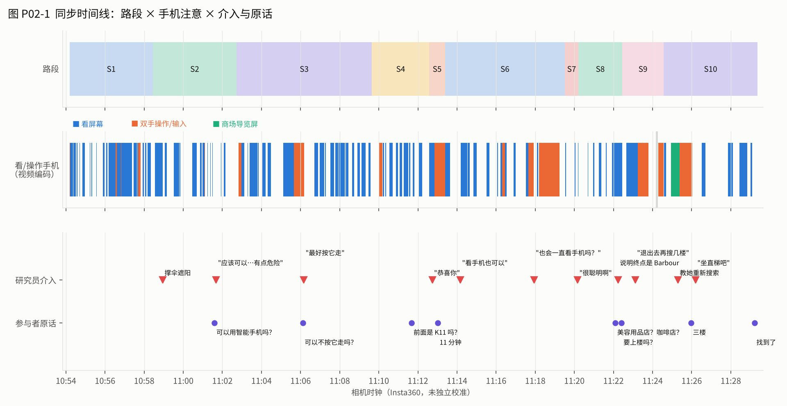
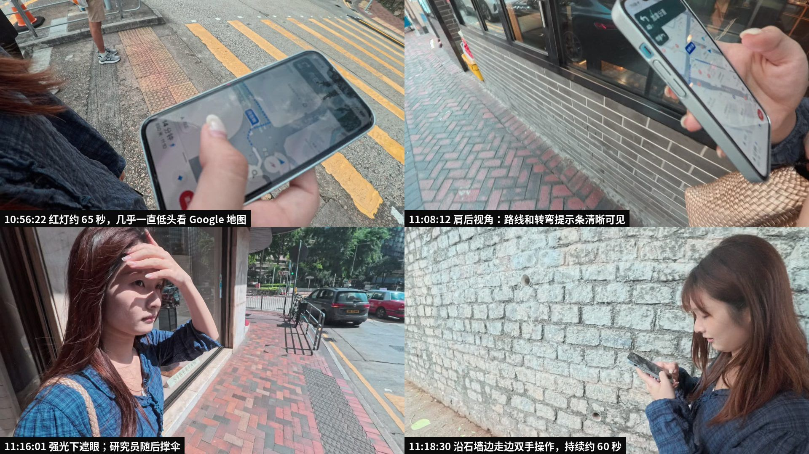
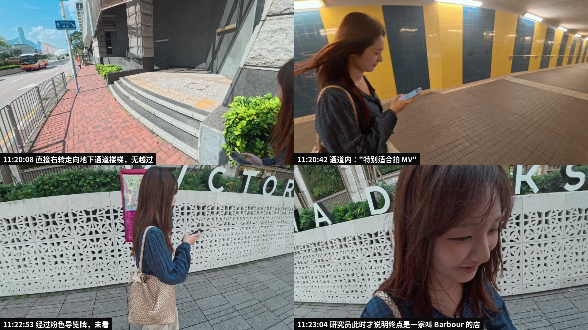
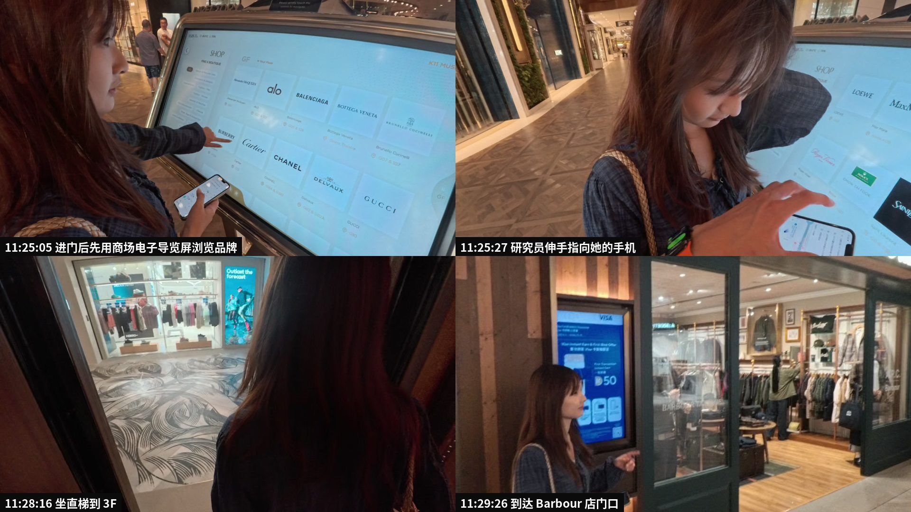
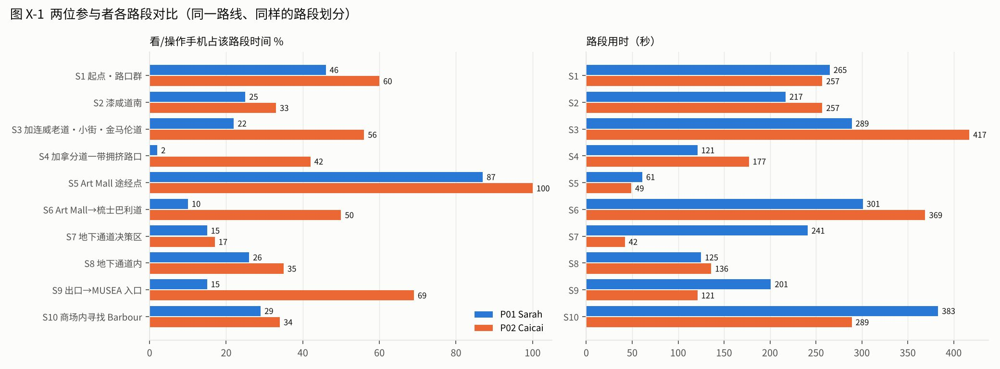

# P02 · UserB-Caicai · 视频优先的观察解析，及与 P01 的对照

**状态：研究者分析稿（v1，2026-10-28），待团队核对。** 方法与 [P01 报告](P01_2026-10-27_video-first-report.md)相同：只用视频画面和音轨重建整场观察。P02 **没有研究员语音笔记、GPS 轨迹、记录表或走后访谈**，所以不做"与笔记对照"那一步，改为与 P01 对照。

证据层次标注与 P01 报告一致：**观察**（画面或音轨直接可见可听）/ **原话**（参与者当场说的话）/ **解读**（研究者推断）。

## 0. 摘要

1. **同一条路线，困难点不同。** P02 在 P01 最难的两处都很顺利：地下通道是一次右转直接下楼（P01 越过两个入口后折返）；MUSEA 是直接从正门进入（P01 沿外立面走过正门）。她的困难反而集中在**任务本身不清楚**和**室内定位**。
2. **她在出发约 28 分钟后才知道终点是一家叫 Barbour 的店。** 11:22 时她还在问"美容用品店？咖啡店？""要上楼吗？"。P01 也问过"Barbour 是啥"。**这是研究设计的问题，不是参与者的问题。**
3. **她看手机多得多。** 全程约 48% 的时间在看或操作手机（P01 约 24%），平均每分钟开始看 3.1 次（P01 2.4 次）。差异主要在 P01 几乎不看手机的路段：拥挤路口 42% 对 2%，Art Mall 之后的路段 50% 对 10%。
4. **她用了商场的电子导览屏，P01 没有用。** 但她是按品牌方块逐个浏览，没有使用搜索，大约 27 秒后改回手机。
5. **研究员介入约 11 次**，比 P01 更频繁，性质也更杂：撑伞遮阳、准许用手机、要求"按它走"、对她看手机的习惯发表评论、夸她"很聪明"、说明终点、教她重新搜索、建议坐直梯。其中至少一次（"你正常导航也会一直看手机吗？"）可能改变了她之后的行为。
6. **天气和身体状态是这一场不可忽略的情境。** 强光和炎热下，她多次遮眼、擦汗，研究员几乎全程撑伞。手机屏幕在强光下是否看得清，可能影响她看手机的方式。

## 1. 资料与边界

| 资料 | 内容 | 限制 |
|---|---|---|
| Insta360 GO Ultra 视频（LRV 007：30 分钟；008：5 分 14 秒） | 正式任务全程；研究员手持或佩戴，多为从她肩后或身侧拍摄 | **时钟未校准**；两段之间有约 8 秒空档；4K 原片过大，本次用 720p 代理文件 |
| 视频音轨 | 参与者与研究员对话 | 声纹聚类按内容推断身份；粤语片段识别较差 |
| 4 张照片（2026-10-26 16:09） | 同一部相机的测试照 | 不属于本场 |
| LRV 006、009（约 1 秒） | 测试片段 | 无内容 |
| **缺失** | GPX（她 10:54 说"我开始记录"，但没有收到文件）、研究员笔记、v3 记录表、warm-up 记录、走后访谈 | 无法计算距离，也没有参与者的事后解释 |

**时钟问题需要你确认**：P02 结束于相机时间 11:29，而 P01 在 PolyU 的任务说明（iPhone 时间）是 11:33:56。两地步行需要 25 分钟以上。如果两场是同一组人先后进行的，Insta360 的时钟至少差 30 分钟；如果是两组人同时进行，时钟可能是准的。**下面全部使用相机时钟**，只用于本场内部的先后与时长。

编码：2,113 帧逐张查看。P02 手机注意区间的精度约 ±2 秒，比 P01 粗，跨案例比较只看大的差异。

## 2. 全程概览

| 路段 | 相机时钟 | 时长 | 手机注意 | 主要特征 |
|---|---|---|---|---|
| S1 起点·路口群 | 10:54:11–10:58:27 | 4:17 | 60% | 一次红灯约 65 秒，几乎全程低头看地图，绿灯亮后才起步 |
| S2 漆咸道南 | 10:58:27–11:02:43 | 4:17 | 33% | 研究员开始撑伞；她问能否用智能手机 |
| S3 加连威老道·小街·金马伦道 | 11:02:43–11:09:39 | 6:57 | 56% | 在 HKCS 转角停约 30 秒并折返；问"可以不按它走吗？" |
| S4 拥挤路口 | 11:09:39–11:12:35 | 2:57 | 42% | 跟着人流过马路，同时仍在看手机 |
| S5 Art Mall 途经点 | 11:12:35–11:13:23 | 0:49 | 100% | 把屏幕展示给镜头；研究员说"恭喜你" |
| S6 Art Mall → 梳士巴利道 | 11:13:23–11:19:31 | 6:09 | 50% | 研究员评论她看手机的习惯之后，她沿石墙边走边操作约 60 秒 |
| S7 地下通道决策区 | 11:19:31–11:20:12 | 0:42 | 17% | **直接右转下楼梯** |
| S8 地下通道内 | 11:20:12–11:22:27 | 2:16 | 35% | 抬头看、赞叹"特别适合拍 MV"、看墙上指示牌 |
| S9 出口 → MUSEA 入口 | 11:22:27–11:24:34 | 2:08 | 69% | **研究员这时才说明终点是 Barbour**；她开始搜索 |
| S10 商场内 | 11:24:34–11:29:22 | 4:49 | 34% | 先用导览屏，再回到手机，坐直梯到 3F，到店 |

全程约 **35 分 11 秒**（手册估算 28 分钟）。Art Mall 用时约 18 分 24 秒，比 P01 的约 15 分 06 秒慢；Art Mall 之后约 16 分 47 秒，比 P01 的约 21 分 28 秒快。

## 3. 关键片段

### E01 起点：屏幕几乎占满第一个红灯（S1）

- **观察**：10:56:15–10:57:23 等红灯约 65 秒，几乎全程低头看浅色主题的 Google 地图，中间两次双手缩放（10:56:32–35）。其他行人 10:57:17 开始过马路，她约 6 秒后才起步。左手一直拿着移动电源和数据线。
- **解读**：P01 在同一个路口会在屏幕和信号灯之间交替看，P02 几乎只看屏幕。这说明"红灯是低风险确认窗口"因人而异：对 P02 来说，这段时间是在补看信息，而不是顺便扫一眼。

### E02 "可以不按它走吗？"：研究约束与真实导航的冲突（S3）
- **观察**：11:05:39–11:06:10，在 HKCS 转角停约 30 秒，双手操作手机，随后往回走了一小段。
- **原话**："可以不按它的走？"（11:06:07，转写为"可以不让他的走"，需对照原音频）
- **R**："我不能干预你""我得拍一下手机"（11:05:55–11:06:00）；"最好是按它的走，是固定的路线""你是走错了吗？没事，你就走吧"（11:06:10–17）。
- **解读**：她可能想抄近路或换路线，研究员要求她按固定路线走。这正是手册"不纠正普通导航选择"与"统一路线"之间的张力，需要定一个规则：允许偏离，但如实记录。

### E03 研究员评论她看手机，可能改变了行为（S6）
- **原话与 R**："你正常导航也会一直看手机吗？"（R，11:17:56）；她笑着回答（11:18:01–11:18:11，转写不清）。紧接着研究员说"那模拟越真实越好"（11:18:28）。
- **观察**：此后约 60 秒（11:18:11–11:19:14），她沿石墙边走边双手操作手机，屏幕是深色的，看不清内容。
- **解读**：这一句评论本身就是一次介入，可能让她刻意表现得"更自然"或"更像平时"。这一段的手机行为不能直接当作导航需求，分析时要单独标注。

### E04 地下通道：一次右转直接下楼（S7–S8）

- **观察**：11:19:31–11:20:06 沿建筑基座边走边看前方，几乎不看手机；11:20:07–11 右转上台阶，直接走向地下通道楼梯，杆顶有蓝色"Subway 隧道"牌。研究员随即说"很聪明啊"（11:20:10）。
- **原话**：通道内"哇塞"（11:20:34）、"特别好适合拍那个 MV 呀"（11:20:42）。
- **解读**：她与 P01 在同一个入口表现完全相反，可能的原因有几种：
  - 接近转换点时她抬着头，而不是在看手机。
  - 她更紧跟 Google 地图的路线。
  - 她事先熟悉这一带。
  - 研究员的暗示。

  视频无法区分这几种可能，需要访谈。这个对照强有力地支持一个假设：**错过转换点与当时视线在哪里有关**，不是单纯因为信息不足。

### E05 直到 11:22 才知道终点是哪家店（S9）
- **R 与原话**：R 说"你要导到一家店里，就是你看一下那个目的地"；她问"美容用品店？咖啡店？"；R 说"好像是一家衣服，它叫 Barbour"；她问"要上楼吗？"；R 说"这个不能提示……但是在 K11 里的一家店"（11:21:58–11:22:37）。随后 R 又说"应该在那个导航里面，你可以退出去，再找看一下几楼"（11:23:04–11）。
- **观察**：此后她边走边双手输入，连续约 30 秒（11:23:15–46），经过一块粉色地图导览牌时没有看（11:22:53）。
- **解读**：她前 28 分钟的导航目标其实是 K11 MUSEA，而不是 Barbour。所以 S9、S10 测到的是"临时得知新目标后的重新规划"，不是从起点一路导航到店。P01 也有同样的问题。**手册里的任务说明需要在出发前就讲清店名、店的类型和"在商场里"。**

### E06 商场内：导览屏用了，但用法不对路（S10）

- **观察**：
  1. 11:24:34 从正门直接进入。
  2. 11:24:56–11:25:22 使用 K11 电子导览屏，进入 SHOP 后逐个看 GF 的品牌方块（Burberry、Cartier、Chanel…），左手同时拿着手机地图。
  3. 11:25:23 改回手机，双手搜索约 38 秒。11:25:27 研究员伸手指向她的手机。
  4. 11:26:12 研究员建议坐直梯；11:27:38 进电梯，11:28:16 到 3F。
  5. 在 3F 边走边看地图，11:29:11–13 指向前方说"找到了"，11:29:26 在 Barbour 店门口。
- **R**："看一下导航，它会写几楼；可以退出去，重新搜一下这家店，完全退出去"（11:25:18–34）。有人拼读"BAR-BOUR"（11:25:41）。"你坐直梯吧"（11:26:12）。
- **原话**："三楼……它还没开业？"（11:25:58）
- **解读**：
  - 她主动选用了环境中的信息源，这一点与 P01 不同。
  - 但导览屏按楼层和品牌方块组织，Barbour 不在 GF，没有搜索就找不到。这与 P01 的 J1 指示牌是同一类问题："信息在场，但组织方式与意图不匹配"。
  - 楼层信息最终来自手机加研究员的方法提示。到 3F 后她找得比 P01 快：手机地图在室内也给出了方向，之后约 1 分钟就到了店门口。

### E07 炎热与强光（全程）
- **观察**：
  - 研究员从 10:58:57 起多次撑伞。
  - 她在 11:02:19–30、11:05:07、11:16:00–03 等时刻遮眼或摸额头。
  - 11:13:49 研究员问她要不要停下来喝水。
- **解读**：身体舒适度会占用注意，也会影响屏幕可读性。这是 P01 报告里没有单列的情境变量。另外，撑伞让研究员一直贴身，社交在场和"被照顾"的感受可能都影响了她的行为。

## 4. 与 P01 的对照

| 转换点或情境 | P01 Sarah | P02 Caicai | 对框架的意义 |
|---|---|---|---|
| 起点路口群 | 46%；平举手机定向 | 60%；红灯时几乎只看屏幕 | 同一情境下手机依赖程度有个体差异 |
| 拥挤路口 | **2%**，靠扫视和跟人流 | 42%，跟人流但仍在看 | "拥挤时放下手机"不是普遍规律 |
| 途经点切换 | 路线消失又出现，"像绕远路" | 展示到达界面，研究员"恭喜你"；新的预计时间"11 分钟" | 两人在这里都 87–100% 看手机，是共同的高需求点 |
| 平面转地下通道 | 低头看手机时走过两个入口，折返约 3 分钟，问路 | 抬头接近，直接下楼 | **视线在哪里**比信息有没有更关键（待验证） |
| 室外转商场入口 | 走过正门约 50 秒，研究员指回 | 直接从正门进入 | 大楼认得出不等于门认得出；P02 可能跟着手机定位 |
| 得知终点店名 | 约 12:13 才问"Barbour 是啥" | 11:22 才问"美容用品店？" | **两人都在任务后段才知道目标**，属于协议问题 |
| 楼层与铺位 | 高德查到 3F；导览屏经过两次没用；靠"B 开头"提示到店 | 用了导览屏但没找到；手机加研究员教方法查到 3F；坐直梯，到 3F 后约 1 分钟找到 | 室内信息需求：楼层 → 铺位 → 店面识别 |
| 研究员介入 | 7 次 | 约 11 次，含评论和夸奖 | 介入程度不一致，影响两人"到达"的可比性 |
| 情绪 | 轻松，多次自嘲"完蛋了" | 轻松，赞叹通道"适合拍 MV" | 两人都把困难和乐趣放在一起说 |

**跨案例的初步 insights（待更多参与者检验）：**
1. **转换点仍然是困难的主要位置**，但同一个转换点对不同人难度不同。框架应记录"转换点 × 当时的注意状态"，不能只记录转换点本身。
2. **手机依赖程度是一个个体变量。** P02 在 P01 几乎不看手机的地方仍然高频查看。分析时应把参与者的平时习惯（访谈或问卷）作为背景，否则会把个体差异误读成情境效应。
3. **环境信息源都存在，但组织方式不对。** P01 的 J1 牌用港铁出口编码，P02 的导览屏按楼层和品牌方块排列。两者都要求用户先知道"它在哪一层""它叫什么出口"。这可以作为分类框架"重复与重合"维度下的一个具体问题。
4. **任务协议正在制造"最后一段"的困难。** 两人都在后段才知道店名和店的类型。在修改协议之前，S9–S10 的数据要谨慎解读。

## 5. 执行问题（P02 新增或更严重）

| 问题 | 证据 | 建议 |
|---|---|---|
| 终点说明不完整 | 11:22 才说明"是一家叫 Barbour 的服装店" | 出发前统一告知店名、店的类型、"在 K11 MUSEA 商场内"，并请她复述 |
| 介入频繁且性质不一 | 约 11 次，含评论行为（"也会一直看手机吗？"）和评价（"很聪明"） | 研究员只回答流程问题；不评论、不夸奖；所有介入记 R |
| 路线规则冲突 | "最好按它的走，是固定的路线" | 定规则：允许偏离并照实记录，或明确要求按 App 路线 |
| 撑伞贴身陪同 | 10:58 起几乎全程 | 天热时可以接受，但要记录；拍摄者尽量保持 2–3 米距离 |
| GPS 未收到 | 10:54 "我开始记录"，没有文件 | 向她要 GPX 导出；出发前检查录制状态 |
| 没有走后访谈 | 视频在到店后 4 秒结束 | 补做回顾访谈：HKCS 转角为什么想换路、为什么能直接找到地下通道、导览屏的使用 |
| 相机时钟 | 与 P01 时间冲突 | 开拍时对镜头展示手机时钟 |

## 6. 局限
- 单人编码，P02 的区间精度较粗（约 ±2 秒），跨案例比较只看大的差异。
- 没有 GPS 和访谈，无法确认路线偏离、距离和她的事后解释。
- 屏幕在强光下大多看不清，60 秒连续操作的内容无法判断。
- 两位参与者都有研究员贴身陪同，而且介入程度不同，跨案例差异可能部分来自研究员行为。

## 7. 建议的下一步
1. 确认两场是否同时进行，以及 Insta360 时钟是否准确。
2. 向 P02 要 GPX 文件，并补做回顾访谈。图 P02-3、P02-4、P02-5 的画面可以用作提示。
3. 团队修订任务说明与介入规则后，再进行 P03。
4. 第三位参与者之后，开始在分类框架里试用"转换点 × 注意状态"的编码。

## 附件
- [逐秒编码日志](P02_video_coding_log.md) · [手机注意区间](P02_phone_intervals.tsv) · [分说话人转写](P02_2026-10-27_audio_diarized_ASR.md)
- 原始视频及派生的代理文件和静帧：本机与 Google Drive 的 `Navigation Observations/UserB-Caicai/` 及 `_derived/UserB-Caicai/`
