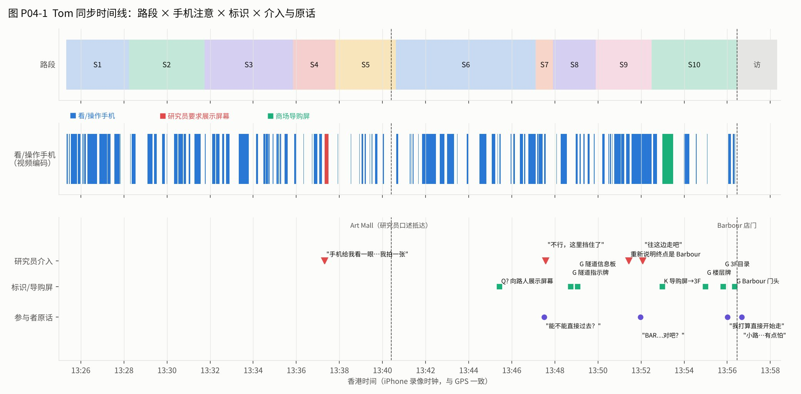
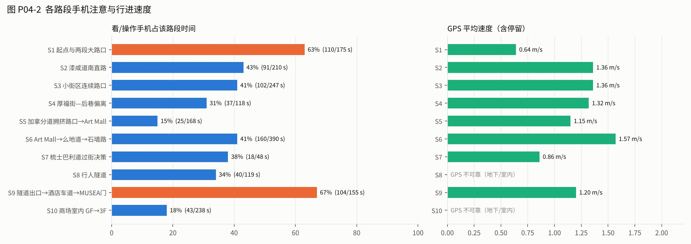
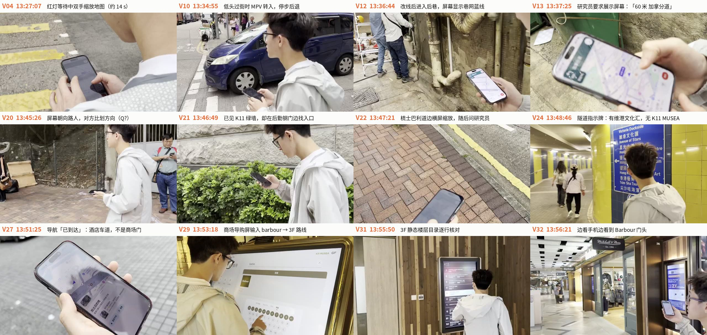

# P04（UserD-Tom）视频优先分析报告

**日期**：2026-10-28　**路线**：PolyU 南门 → K11 Art Mall（途经）→ K11 MUSEA Barbour 3F 319
**性质**：单一参与者的待核对分析，不是研究结论。按团队要求，本报告只分析 Tom 本人，不与其他参与者比较。

配套文件：[片段编码（筛选结果）](P04_video_coding.md) ｜ [逐秒原始笔记](P04_video_frame_log.md) ｜ [手机注意区间](P04_phone_intervals.tsv) ｜ [音轨转写](P04_2026-10-28_audio_diarized_ASR.md)

---

## 0. 资料与方法

| 资料 | 内容 | 用法 |
|---|---|---|
| IMG_1793.MOV | 正式任务，13:25:19–13:58:19 HKT，33 分 01 秒；研究员 iPhone 手持跟拍，多为背后或侧后视角 | 每秒一个关键帧逐张编码（1,987 帧） |
| IMG_1789.MOV | Warm-up，13:14:14 起，1 分 50 秒，校园内 | 背景，不进入主分析 |
| 音轨 | 研究员的口述语音备忘 + Tom 的话 + 到达后约 2 分钟现场访谈 | 声纹分离 + 自动转写，对照视频 |
| GPX | 参与者手机，13:25:25–13:58:44，703 点 | 路段距离与速度；隧道和商场内不可靠 |
| 照片 | IMG_1790（13:34:40）、IMG_1791（13:37:36，「60 米 加拿分道」）、IMG_1792（13:51:50，「抵达目的地」） | 核对屏幕内容 |

iPhone 时钟与 GPS 一致，不需要校正。流程与 P01、P02 相同：先只看视频，再用音频补充，最后对照研究员的语音备忘。路段划分沿用 S1–S10，具体边界按 Tom 的实际路线调整（见第 2 节）。

**限制**：镜头大多在背后，看不到眼睛，P（看手机）按头部低垂且手机在视线范围内判断，可能低估短暂瞥视；从背后无法核实「用手机对准方向」这类动作。转写未经人工校对，说话人分离把多数话语都归给了研究员。

## 1. 摘要

- **用时**：起点到 Barbour 店门 31 分 08 秒（13:25:19–13:56:27）。研究员在 13:40:35 宣布抵达 Art Mall，第一段 15 分 16 秒，第二段 15 分 52 秒（含约 1 分钟重新说明任务）。
- **手机注意**：步行期间 39% 的秒数在看或操作手机（730/1,868 秒），约每分钟开始 3.3 次。去掉研究员要求或引发的操作（V13、V27，共 42 秒）后为 37%。手机几乎全程拿在手上。
- **标识与求助很少**：看标识（G）只在隧道和商场里出现；向陌生人求助只有一次待定（V20）。Tom 主要依赖 Google Maps，到了室内才转向商场设施。
- **最难的两处**与 Tom 自己在现场访谈中说的一致：改线后进入的**后巷**（V12）和**无法直接过梳士巴利道**（V21–V22）。
- **最后一段的问题出在「进入方式」而不是「方向」**：看到 K11 后，他先走到建筑后勤一侧，再被马路挡住，经研究员回答才找到隧道；出隧道后，Google Maps 的终点又是酒店车道，不是商场入口（V26–V27）。
- **研究员介入 4 次**，其中两次改变了后续行动（V22 回答不能过马路；V27 重新说明终点并指方向）。Tom 到 13:51 才知道要找的是 Barbour。

## 2. 路段指标

| 路段 | 时间（HKT） | 用时 | 看/操作手机 | 每分钟次数 | GPS 速度 | 主要片段 |
|---|---|---|---|---|---|---|
| S1 起点与两段大路口 | 13:25:19–13:28:14 | 2:55 | **63%** | 4.1 | 0.64 m/s | V03、V04（77 秒红灯） |
| S2 漆咸道南直路 | 13:28:14–13:31:44 | 3:30 | 43% | 3.1 | 1.36 m/s | V05–V07 |
| S3 小街区连续路口 | 13:31:44–13:35:51 | 4:07 | 41% | 3.6 | 1.36 m/s | V08–V10 |
| S4 厚福街—后巷偏离 | 13:35:51–13:37:49 | 1:58 | 31% | 3.1 | 1.32 m/s | V11–V13 |
| S5 加拿分道拥挤路口 → Art Mall | 13:37:49–13:40:37 | 2:48 | **15%** | 3.2 | 1.15 m/s | V14–V16 |
| S6 Art Mall → 么地道 → 石墙路 | 13:40:37–13:47:07 | 6:30 | 41% | 2.9 | 1.57 m/s | V17–V21 |
| S7 梳士巴利道过街决策 | 13:47:07–13:47:55 | 0:48 | 38% | 3.8 | 0.86 m/s | V22 |
| S8 行人隧道 | 13:47:55–13:49:54 | 1:59 | 34% | 3.5 | 不可靠 | V23–V24 |
| S9 隧道出口 → 酒店车道 → MUSEA 门 | 13:49:54–13:52:29 | 2:35 | **67%** | 3.1 | 1.20 m/s | V25–V27 |
| S10 商场室内 GF → 3F | 13:52:29–13:56:27 | 3:58 | 18%（另有导购屏约 30 秒） | 2.0 | 不可靠 | V28–V32 |

户外 S1–S7 的 GPS 距离约 1.74 km；第一段（S1–S5）约 1.08 km，平均 1.18 m/s。

**怎么读这些数字**：S1 和 S9 最高，但原因不同。S1 是两次长红灯（停着的时候看手机），S9 是找入口和研究员要求重新搜索。S5 最低，是因为人太多，他把注意力给了人群和信号灯。单看百分比会把「等候中的查看」和「迷路中的查看」混在一起，后续整体编码应把 S+P/I（停步时）与走动中的 P/I 分开统计。

## 3. 主要发现

每条先写**观察**（视频可见），再写**解读**（推论，待访谈或其他参与者验证）。

### F1 停步时操作，走动时预读；过街时的切换并不稳定

**观察**：最长的两段手机操作都在红灯下：V04 的 77 秒停步中约 40 秒在缩放、拖动地图；V18 停在路缘约 25 秒连续输入。直路上他也会连续看 14–17 秒（V02、V06）。在无灯小路口，他有时会自己放下手机看车（V05，v208–214），但在 V10 正在找方向时，一辆 MPV 转入，他停步后退才反应过来。第一个大路口过斑马线时，他大部分时间低头（V03）。

**解读**：等灯是他自然的「查看窗口」；走动中的查看更像预读下一步。安全上的切换取决于当时是否同时在找方向：任务一重，对车辆的注意就被挤掉。

### F2 「拿着手机」不等于「在用导航」

**观察**：手机几乎全程拿在手上，但步行期间只有 39% 的时间看着它。研究员在 S5 记录「手机使用频率变高，一直握持手机在看导航方向」，视频中这一段看屏只有 15%，等灯和过街时他抬头看人群和信号（V15，另做 2 秒间隔放大抽查确认）。研究员自己在 S2 也说过「虽然拿着手机，但视线不在手机上」（V06）。

**解读**：现场观察者容易把「手持」理解为「使用」。这既是方法问题（P 只按可见视线编码；需要侧前方视角），也说明手机对 Tom 有「随时可用」的安抚作用，即使不看也要拿着。后者需要访谈确认。

### F3 改线把他带进「不像路的路」，这是他自己认为压力最大的地方

**观察**：在厚福街一带，路线进入后巷服务通道（V12）：垃圾桶、管道、工人钻墙，没有其他行人。他频繁看屏，停下来双手缩放。研究员还在这里要求他展示屏幕拍照（V13）。出巷后他先抬头确认街道（V14）。现场访谈中他说：「那个小路……有点怕，说实话」、「不像是一个正经的路」，并认为是自己走错一步，Google Maps 改线才变成小路，注意力负担最大的也是这里（C01）。

**解读**：对新来者来说，路线是否「可信」不只取决于距离，还取决于这条路看起来像不像给行人走的。改线如果没有说明，用户会怀疑自己和导航。

### F4 小街区里，他需要把屏幕上的街和眼前的街逐个对上

**观察**：进入街区后，看屏和转头都变密（V08）；在窄街中边走边滑动地图约 28 秒（V09）。在 V18，研究员事后指出 Google Maps 只提示走左侧，但右侧也能走，导致他停下来反复确认，随后还打开了键盘。全程没有观察到他读路名牌（V11 只有一次待定）。

**解读**：导航只给一条线，没有说明哪些偏差无所谓，用户就会为不重要的选择付出确认成本。相似街口之间缺少可对照的特征（路名牌不显眼或不被使用）。

### F5 最后几百米：看得见目标，不知道怎么进去

**观察**：在石墙路上他已经能看到带「K11」的绿墙（V21），却跟着一位路人走进平台底层的后勤通道，在不锈钢门之间找入口；屏幕在日光下发白，他连续看屏约 20 秒。到梳士巴利道后，他把手机转成横屏缩放，然后问研究员「能不能直接过去？」，研究员答「不行」（V22）。约 20 秒后他找到了旁边的隧道入口（V23）。访谈中他说：「我以为可以直接穿过去，地图上没有标明」。

**解读**：地标解决了方向，但没有解决进入方式。过街设施（隧道）在地图上不是一个明确的步骤，入口又不显眼。研究员的回答在这里改变了结果，所以这一段不能算作他独立完成。

### F6 名称对不上：标识写「维港文化汇」，导航终点是酒店车道

**观察**：隧道里他三次在指示牌和手机之间切换（V24）。指示牌列出「Victoria Dockside 维港文化汇 / 星光大道 / 文化中心……」，没有「K11 MUSEA」。出隧道后，Google Maps 把他带到一条酒店落客车道（研究员口述终点为「ro…」，推测是 Rosewood），屏幕显示「已到达」，但他不在商场门口（V26、V27）。这一段看屏占 67%，全程最高。

**解读**：用户要的是「可以进去的门」，地图给的是「一个地点」；现场标识用的是开发项目名，导航用的是商场名。用户需要自己推断这几个名称之间的关系。

### F7 进入室内后，他把主要信息源换成商场设施

**观察**：进门后他停下来缩放 Google Maps 约 8 秒（V28），研究员口述「导航上的地面非常混乱」。随后他在电子导购屏后等了约 13 秒，再自己搜索「barbour」，得到「需要到 3 楼」和路线（V29）。之后每一层都要重新找扶梯（V30，在 1F 绕了约 20 秒），到 3F 先看静态楼层目录（V31），最后边看手机边看到 Barbour 门头（V32）。室内看手机只占 18%。

**解读**：在室内，导购屏、楼层牌和目录板组成了一条信息链，手机只作辅助。导购屏提供了手机缺少的关键信息（楼层），但需要排队。

## 4. 与研究员语音备忘的对照

研究员的口述在视频音轨中（自动转写约 140 段，多数为研究员口述）。下表列出与行为有关的主要判断。

| 时间 | 备忘内容（转写，未校对） | 对照结果 | 片段 |
|---|---|---|---|
| 13:25:59 | 「一直就是看手机确认方向」 | 印证 | V02 |
| 13:27:51 | 「又往回看了一眼，确认方向」 | 无法确认（此时镜头转向路口） | V04 |
| 13:29:15–13:30:05 | 「低头看手机」；「拿着手机但视线不在手机上，状态很轻松」 | 印证（两者交替） | V06 |
| 13:31:24–31 | 「步速比较快，直道参照物明显」 | 印证（1.36 m/s） | V07 |
| 13:31:44–13:32:36 | 「拐角又低头 check……手机操作和左右看的频率明显变快」 | 印证 | V08 |
| 13:33:52 | 「利用看地图的间隙去看哪一条道是哪一条道，block 多」 | 印证，且看到的是边走边操作 | V09 |
| 13:35:42 | 「刚刚录制暂停了一小会儿……反复看 Google Map 和左右回看」 | 行为印证；视频连续无暂停，「暂停」所指待确认 | V12 |
| 13:36:48 | 「有一小段路线偏离，可能走错了路」 | 与 Tom 访谈一致 | V12、C01 |
| 13:38:45 | 「步伐慢了下来，手机使用频率变高，一直握持手机在看导航」 | **部分不符**：变慢、手持属实；看屏只有 15%，为全程最低 | V15 |
| 13:39:06、13:44:07 | 「拿手机有指示方向的作用」；「用手机的方向对准正前方」 | 背后视角无法核实 | V15、V19 |
| 13:40:24–37 | 「成功抵达 Art Mall」 | 与 GPS 一致；画面中没有 Art Mall 标识，Tom 本人没有表现出到达 | V16 |
| 13:40:57–13:41:21 | 「走得非常快，看手机频率降低」 | 印证（1.57 m/s） | V17 |
| 13:41:57 | 「哎呀，闯红灯」 | **不符**：Tom 等到绿灯才过；可能指他人，待确认 | V18 |
| 13:42:13、13:43:30 | 「红灯期间放大屏幕找方向」；「Google Maps 显示走左侧，其实右侧也可以，没有提示导致疑惑」 | 印证；后一句是研究员的解释，需访谈确认 | V18 |
| 13:45:19–40 | 「步频变快，看手机变少」；「手机收起来了，似乎看到了 K11 地标」 | 印证；视频中 K11 绿墙首次可见是 13:46:08，比备忘晚 | V20、V21 |
| 13:46:23 | 「在看手机如何进入」 | 印证 | V21 |
| 13:47:30–57 | 「用户问能不能直接过去」；「发现了隧道往下走」 | 印证；研究员的回答本身是介入 | V22、V23 |
| 13:50:51–13:51:18 | 「终点设置的是 ro 这家店」；「低头抬头变多，在 check 入口」；「迷失了方向」 | 印证；终点名称待核 | V26、V27 |
| 13:52:41–13:53:33 | 「导航上的地面非常混乱」；「看导航牌……需要到 3 楼」 | 印证 | V28、V29 |
| 13:53:49 | 「坐扶梯到商场二楼」 | **不符**：实际到 1F | V30 |
| 13:54:25、13:55:47 | 「很多左右看路线」；「去看了商场的指示牌」 | 印证 | V30、V31 |

**统计**：约 22 条印证，5 条部分印证或无法核实，3 条不符。

**只有视频才看到的内容**（共 12 项）：过斑马线时低头（V03）；身边指路牌未被使用（V04）；无灯路口自发放下手机（V05）；与转弯 MPV 的冲突（V10）；研究员距离过近碰到他的头（V11）；向路人展示屏幕（V20）；屏幕在日光下发白或变黑（V21）；横屏缩放（V22）；隧道中标识与手机交替、名称对不上（V24）；排队等导购屏（V29）；在 1F 绕路（V30）；到达时一边看手机一边看门头（V32）。

**对语音备忘的改进建议**：
1. 把「手里拿着」和「眼睛在看」分开说，例如「手机在手，抬头看车」。
2. 安全事件当场记一句（V10 没有被记录）。
3. 楼层、路名当场确认后再口述，避免事后要改。
4. 研究员自己的介入也要口述记录（「我回答了他不能过」），方便之后标 R。

## 5. 执行问题

| 问题 | 证据 | 建议 |
|---|---|---|
| 研究员介入 | V13 要求展示屏幕拍照；V22 回答「不能过」；V27 重新说明终点并说「往这边走吧」 | 拍屏改为事后截图或屏幕录制；参与者提问时统一回答「请按你自己的判断」；必须介入时口述记录 |
| 任务说明 | Tom 在 13:51 才被告知要找 Barbour；第二段目标对他来说一直不清楚 | 出发前统一说明完整终点，并请参与者复述（与 OPEN_QUESTIONS「任务说明」一致） |
| 途经点 | Art Mall 由研究员宣布，画面没有标识，Tom 也没有到达行为 | 统一途经点的具体位置（某个门或标识），到达时请参与者自己确认 |
| 拍摄视角 | 背后视角看不到视线，S5 的判断因此出现分歧 | 加侧前方视角（例如挂脖相机）或请参与者开启屏幕录制 |
| 研究员距离 | V11 镜头碰到 Tom 的头 | 保持 1–2 米 |
| 参与者标签 | 研究员口述中称 Tom 为「用户 C」，文件夹为 UserD | 统一编号；本仓库用 P04 = UserD-Tom |
| 资格 | 未见 Tom 来港时长、使用习惯等资料 | 补齐筛选问卷 |

## 6. 初步设计机会（单一案例，待跨案例验证）

| # | 机会 | 依据 |
|---|---|---|
| D1 | **按状态分配信息**：停步时给完整的接下来两步；走动时只给下一个动作；接近无灯过街或转弯车多的路口时，暂缓需要阅读的信息 | F1（V03、V04、V05、V10） |
| D2 | **改线时说明原因和路的性质**（例如「经后巷，较窄，无其他行人」），并提供回到主路的选项 | F3（V12、C01） |
| D3 | **告诉用户哪些偏差没关系**（「两侧都可以走」），减少不必要的确认 | F4（V18） |
| D4 | **最后 300 米从「距离」切换到「进入方式」**：把隧道、天桥、入口作为明确的步骤，例如「前方 30 米下隧道，走维港文化汇出口」 | F5、F6（V21–V24） |
| D5 | **目的地精确到门**，并把地图名称与现场标识名称对应起来 | F6（V26、V27） |
| D6 | **室外到室内的交接**：到入口时显示楼层、最近的扶梯和室内标识的叫法，让手机和商场导视接上 | F7（V28–V31） |

这些只来自 Tom 一个人，属于后续整体编码时要检验的假设，不是结论。

## 7. 正式访谈可追问的问题

1. 在直路上一直拿着手机、但很多时候不看，拿着是为了什么？（V06、V15）
2. 第一次大路口身边有蓝色指路牌，你注意到了吗？平时会看路名牌吗？（V04、V09）
3. 后巷那里，你觉得是自己走错了还是导航带错了？如果当时导航说明了「会经过后巷」，你会怎么选？（V12）
4. 在交通银行路口，你打开键盘是在做什么？（V18）
5. 看到 K11 绿墙之后，你是怎么判断从哪里进去的？（V21）
6. 隧道里的指示牌写的是「维港文化汇」，你知道它和 K11 MUSEA 的关系吗？（V24）
7. 导航说「已到达」时，你觉得自己到了哪里？（V27）
8. 为什么在商场里先去用导购屏，而不是继续用 Google Maps？（V29）

## 8. 图与文件

- 图 P04-1 同步时间线；图 P04-2 各路段手机注意与速度；图 P04-3 关键时刻截图：

- 原始资料位于 Google Drive / 本机 `Navigation Observations/UserD-Tom/`；1 fps 代理视频和音频在 `_derived/UserD-Tom/`（未入库）。
