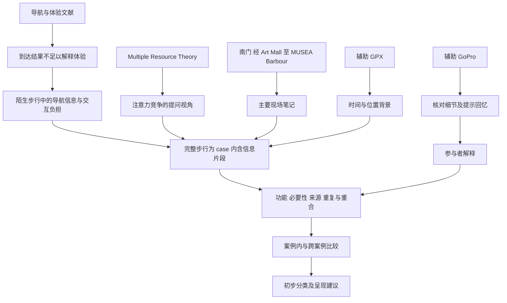

# 知识网 Knowledge network

本知识网把研究问题、理论、证据、分析维度、执行资料及设计产出联系起来。它是根据已保存讨论新整理的导航图；图中的连线表示分析关系或证据用途，不证明因果或学术影响。

## 按问题读文献

| 问题 | 对应来源 | 对项目的作用与边界 |
|---|---|---|
| 为什么并行走路、看路、用手机可能费力 | Wickens；Oulasvirta；Wobbrock | 理论竞争、碎片化及情境限制；不直接测得本组参与者的负荷 |
| 信息多少、什么时候给、如何传递 | Cheng；Golab；Pielot | 信息与时机／通道需要结合任务；不预设越少越好 |
| 看手机与错误如何关联 | Shimokihara | 支持记录事件顺序；相关不证明看手机导致困难 |
| 导航成功如何区别于体验良好 | Vaez；Hardwicke；Schmitt；Chang | 策略、焦虑、安心和能力判断；场景不同，不推导香港步行的完整因果链 |
| 怎样区分功能、重要性与冗余 | May；Anacta；Mackaness | 为初始分类提供邻近依据；不是本组最终分类 |
| 怎样获得和比较解释 | Lazar et al.；Russell & Chi | 观察、访谈、案例与回顾方法；不把回忆当心理机制证明 |

完整条目与保存状态见 [bibliography.json](bibliography.json)。9 月十篇 proposal 文献和 10 月八篇汇报选集分别标注；旧下载清单中的未取得全文条目保持原状态，不冒充已读全文。

## 给 agents 的图谱约定

[graph.json](graph.json) 使用稳定节点 ID、明确关系类型、状态及仓库相对来源路径。`theoretical_lens`、`research_question`、`working_proposal`、`execution_plan`、`user_confirmed_plan` 与 `unverified_status` 不得混用。边是研究整理关系，不是已验证因果关系。

当前参与者节点为 `evidence:P01`–`evidence:P05`（均为未核实证据，P05 只有研究员备忘），跨案例关系指向[跨案例笔记](../docs/fieldwork/CROSS_CASE_NOTES.md)。新增材料时继续使用 evidence ID，区分原始观察、当下报告、事后解释和研究者推断，再将分类与设计建议连接到可检查证据；同时保留反例和替代解释。

来源：[研究简报](../docs/RESEARCH_BRIEF.md)、[9 月文献记忆](../archive/2026-09-21/memory/Safari_SD5008_Memory_Pack/LITERATURE_MEMORY.md)、[历史分类讨论](../archive/discussions/01a0c2e7-9fa8-7cb3-9202-b2636b6eb003.md)、[当前手册](../docs/fieldwork/MANUAL_CN.md)。
